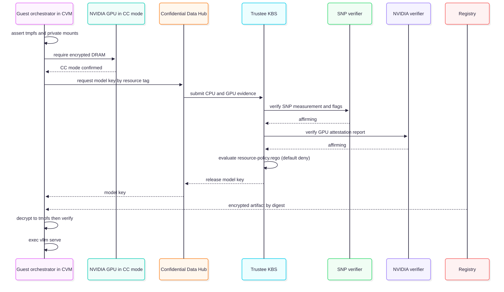

# Confidential inferencing (kata-cc + NVIDIA GPU CC)

This document describes how to extend the multi-agent loan origination system so that model serving runs inside hardware-isolated Confidential VMs (CVMs) using the `kata-cc-nvidia-gpu` runtime class, giving private inferencing where model weights, prompts, activations and KV cache are protected from the cluster, hypervisor and infrastructure administrators.

The baseline it adapts is the Red Hat Confidential Containers (CoCo) validated pattern.

Mortgage lending is a regulated, PII-dense domain: every agent turn assembles a prompt from borrower financial data (SSN, DOB, income, account numbers), application state, and retrieved compliance content, and sends it to a model for reasoning. The weights themselves may be licensed or proprietary. Today, on the serving node, a platform or cloud/host administrator with node access could read the model weights on the PVC or S3-backed cache, and read the prompts, completions and KV cache in GPU and CPU memory. The five persona experiences and the API contract are unchanged (same endpoints, same model aliases), but model serving runs inside an attested confidential VM, so the infrastructure operator -- including a managed-service or cloud admin -- cannot see the weights, the prompts, or the completions. It is the enabler for serving the lending models on hardware the data owner does not administer, or offering this system as a managed/shared service, while still being able to attest that confidentiality holds.

This is opt-in: every piece is gated behind `confidential.enabled` (§8), so with the flag off the chart renders and behaves exactly as it does today (ordinary GPU serving), and turning it off again returns to that baseline.

---

## 1. Goal and scope

Today the system serves models over two paths, both outside any TEE:

- **Primary LLM.** The API's LangGraph agents call the model through [LlamaStack](../deploy/helm/mortgage-ai/templates/llamastack.yaml), which proxies to either an external MaaS / OpenAI-compatible endpoint (`LLM_BASE_URL`) or an in-cluster KServe `InferenceService` (`llamastack.inferenceService.endpoint`).
- **In-cluster vLLM.** The NeMo Guardrails content-safety detector is a KServe `ServingRuntime` + `InferenceService` running vLLM on a GPU ([`nemo-guardrails-model.yaml`](../deploy/helm/mortgage-ai/templates/nemo-guardrails-model.yaml)), with weights pulled from S4/S3.

In both in-cluster cases the serving pod runs with `runtimeClassName` unset (`runc`), the GPU is exposed as `nvidia.com/gpu`, plaintext weights land on a PVC or model-cache, and prompts / completions / KV cache live in host-visible GPU and CPU memory. A cluster admin or anyone with node access can read them.

**Goal:** move the vLLM serving pod(s) into a Kata Confidential VM backed by a CPU TEE (AMD SEV-SNP or Intel TDX) with the NVIDIA GPU in **Confidential Computing (CC) mode**, and release the model decryption key **only after composite CPU + GPU remote attestation** succeeds. The result:

- Weights are distributed **encrypted** (AES-256-GCM) and decrypted only inside the CVM, in memory (tmpfs), after attestation.
- GPU DRAM is encrypted; the GPU proves its CC state via NVIDIA attestation.
- Prompts, completions, activations and KV cache stay inside the measured TEE boundary on the serving node.
- Infrastructure admins see only ciphertext (model artifact, LUKS/tmpfs) and TLS ciphertext.

**In scope** This is a multi-agent application: the API (FastAPI + LangGraph) is the component that *assembles* each prompt, pulling borrower PII from PostgreSQL and context from the compliance KB. To protect prompts end to end, the design co-locates the **agent data plane (the API + LangGraph agents), the LlamaStack inference endpoint, and vLLM in the same confidential VM** (§5.4), so prompt assembly, TLS termination and inference all happen inside the measured TEE boundary -- the plaintext prompt only ever exists inside the CVM. In scope with it: the platform beneath (OSC/Kata, Trustee/KBS, GPU operator CC-mode, attestation policy, encrypted-model pipeline) covering the self-hosted primary-LLM `InferenceService` and the NeMo content-safety detector.

---

## 2. What the base implementation gives us

| Branch @ commit | What it contributes | How we use it |
|---|---|---|
| `codex/edge-rtx6k` @ `46739d16` | Bare-metal Kata CC on AMD SEV-SNP + NVIDIA Blackwell RTX PRO 6000; `kata-cc-nvidia-gpu` RuntimeClass via OSC `KataConfig`; GPU operator CC-mode ClusterPolicy; Trustee/KBS with SNP + NVIDIA verifiers; encrypted-model producer + attesting guest; CUDA/GPU readiness runbooks; pytest suites. | Platform foundation and runtime wiring. |
| `rhoai-confidential-qwen` @ `6c86a49a` / `383fcbda` | Same stack packaged to serve an encrypted Qwen3 workload on a KServe-capable (OpenShift AI) cluster; optional `InferenceService` wrapper around the confidential pod; initdata binding of the protected model-key resource class. | The serving-side integration template -- directly reusable for this system's KServe `InferenceService` serving. Generate new site keys, measurements and bindings. |

The pod does not launch vLLM directly; it launches a Python guest orchestrator (`guest.py`) that attests, fetches the key from the Confidential Data Hub, decrypts into tmpfs, verifies, then `exec`s `vllm serve`. KServe is a thin predictor wrapper around the identical confidential pod spec -- which is exactly the shape this system's content-safety detector and a self-hosted primary LLM already take.

---

## 3. How it maps onto the `mortgage-ai` chart

This system ships a single [`mortgage-ai`](../deploy/helm/mortgage-ai) Helm chart, so the integration threads through its existing templates and adds new, flag-gated ones.

| Area | Exists today | Add for confidential inferencing |
|---|---|---|
| Operators (cluster prerequisites) | RHOAI, NVIDIA GPU operator (installed out-of-chart) | **OpenShift Sandboxed Containers (OSC)**, **Trustee**, **External Secrets Operator (ESO)** installed on the cluster; GPU operator stays but its `ClusterPolicy` changes to CC mode. |
| Platform config (new templates) | None -- GPU/accelerator config assumed present on the cluster | `KataConfig` CR + GPU RuntimeClass reconcile; **CC-mode** `ClusterPolicy`; NFD `NodeFeatureRule` for SEV-SNP/TDX + GPU; **Trustee/KBS** CR + resource policy (`.rego`) + reference values; **CoCo initdata** ConfigMap; **Kyverno** policies that inject initdata into Kata pods (§5.2). |
| Model serving | [`nemo-guardrails-model.yaml`](../deploy/helm/mortgage-ai/templates/nemo-guardrails-model.yaml) (`ServingRuntime` + `InferenceService`, vLLM, `nvidia.com/gpu`); a self-hosted primary-LLM `InferenceService` is supported via `llamastack.inferenceService` | Confidential serving variant of the pod: `runtimeClassName: kata-cc-nvidia-gpu`, GPU as `nvidia.com/pgpu`, initdata mount/annotation, `guest.py` orchestrator, results sidecar; **encrypted-model producer Job**; model key released by KBS (§5.3). |
| Agent data plane + inference entry | [`api-deployment.yaml`](../deploy/helm/mortgage-ai/templates/api-deployment.yaml) (FastAPI + LangGraph) and [`llamastack.yaml`](../deploy/helm/mortgage-ai/templates/llamastack.yaml) run as ordinary pods; no in-TEE termination | Co-locate the **API + LangGraph agents, LlamaStack and vLLM in the CVM** (client TLS terminates in-TEE, LlamaStack and vLLM on loopback -- §5.4); the API's client-facing TLS key released by KBS. No persona or API-contract change. |
| Ingress | OpenShift [`routes.yaml`](../deploy/helm/mortgage-ai/templates/routes.yaml) with `edge` TLS termination for UI + API | A **TLS-passthrough** Route/Gateway in front of the in-CVM API (§5.4, §5.5). |



The serving step runs the agent data plane (API + LangGraph agents), LlamaStack and vLLM together in one confidential VM: the API terminates client TLS inside the TEE, assembles each prompt in-TEE, and calls LlamaStack and vLLM on loopback (see §5.4 and §7). KBS releases both the client-facing TLS material and the model key into that same measured VM.

---

## 4. Hardware and platform prerequisites

The confidential GPU inferencing path has been primarily tested on **bare-metal / on-prem** clusters; it is generally not available on typical managed cloud GPU SKUs today.

| Requirement | Detail |
|---|---|
| CPU TEE | AMD **SEV-SNP** or Intel **TDX**, enabled in BIOS. |
| GPU | NVIDIA **CC-capable** GPU: Hopper (H100/H200) or Blackwell (B200, RTX PRO 6000 Blackwell). CC mode encrypts GPU DRAM and emits attestation reports. Single GPU passthrough per CVM. |
| OpenShift | 4.22+ (OpenShift AI 2.x+ for the KServe serving path). |
| OSC / Trustee | OSC 1.13+, Trustee 1.2+ (base lab versions). |
| GPU operator | 26.3.x with `ccManager` support. |
| IOMMU / BIOS | IOMMU on, interrupt remapping, ACS on bridges, each GPU in its own IOMMU group; host loads **no** NVIDIA driver (driver runs in the Kata guest image). |
| Attestation collateral | AMD VCEK certs (offline store) and/or Intel DCAP collateral; NVIDIA GPU reference values / NRAS remote attestation. |

---

## 5. Component design

### 5.1 Operators and platform prerequisites

The `mortgage-ai` chart does not manage operator `Subscription` objects today (RHOAI and the NVIDIA GPU operator are installed on the cluster out-of-band). For confidential inferencing, three additional operators are required:

- `sandboxed-containers-operator` -> ns `openshift-sandboxed-containers-operator`.
- `trustee-operator` -> ns `trustee-operator-system`.
- `external-secrets-operator` (for Trustee key/collateral delivery; or substitute the key mechanism the deployment prefers -- see §5.3 open decision).

These can be installed as cluster prerequisites, or added as optional `Subscription` templates gated by `operators.confidential.enabled` so non-confidential deployments are unaffected. The NVIDIA GPU operator stays; only its `ClusterPolicy` changes (§5.2).

### 5.2 Platform configuration (new templates)

**RuntimeClass.** Add a `KataConfig` (`kataconfiguration.openshift.io/v1`, name `default-kata-config`) that builds the GPU-enabled Kata guest image (carrying the in-guest NVIDIA driver). OSC generates the `kata-cc-nvidia-gpu` RuntimeClass. Add a Helm hook/Job that forces a re-reconcile when GPU nodes are present but the RuntimeClass is missing.

**GPU CC mode.** Add a confidential variant of the NVIDIA `ClusterPolicy` with the CC/sandbox fields:

```yaml
spec:
  ccManager:
    enabled: true
    defaultMode: "on"            # GPU Confidential Computing mode
  sandboxWorkloads:
    enabled: true
    defaultWorkload: vm-passthrough
  kataSandboxDevicePlugin:
    enabled: true                # exposes nvidia.com/pgpu
  vfioManager:
    enabled: true
  # in-guest driver -> disable host-side components
  driver: { enabled: false }
  toolkit: { enabled: false }
  devicePlugin: { enabled: false }
```

This **conflicts** with the ordinary GPU operator defaults (`driver.enabled: true`, host device plugin exposing `nvidia.com/gpu`), so the confidential ClusterPolicy must be a distinct rendered variant selected by the confidential flag, not an unconditional edit. The NeMo content-safety detector's `opendatahub.io/recommended-accelerators: '["nvidia.com/gpu"]'` annotation and its GPU resource request also change under the confidential variant (§5.3).

**Node selection.** Add an NFD `NodeFeatureRule` to label SEV-SNP/TDX-capable GPU nodes; gate CVM scheduling on those labels.

**Trustee / KBS.** Deploy the KBS (`kbs-config.toml`: HTTPS, `coco_as_builtin`, RVPS `LocalJson`, `admin DenyAll`) with the `snp_verifier` (offline VCEK) and `nvidia_verifier` (`type = Remote`) enabled. Load the **resource-release policy** (`resource-policy.rego`) and reference values. This is the load-bearing authorization gate (§6). Wire key/collateral delivery via ESO -> Vault, or the chosen alternative.

**initdata + injection.** Render the CoCo **initdata** TOML into a ConfigMap: Attestation Agent + CDH pointing at `https://kbs.<domain>`, image security policy URI, and the **Kata agent policy** that fails closed (`ExecProcessRequest` / `ReadStreamRequest` / `WriteStreamRequest` default `false`; only the attestation-status probes whitelisted). initdata is **measured** into attestation evidence. Add the Kyverno `ClusterPolicy` that, on Pod CREATE with `runtimeClassName` in `{kata, kata-cc, kata-cc-nvidia-gpu}` and annotation `coco.io/initdata-configmap`, injects `io.katacontainers.config.hypervisor.cc_init_data`.

### 5.3 Confidential model serving

The current [`nemo-guardrails-model.yaml`](../deploy/helm/mortgage-ai/templates/nemo-guardrails-model.yaml) runs vLLM directly under a KServe `InferenceService`, and a self-hosted primary LLM would take the same shape. For the confidential variant (behind `confidential.enabled`), the serving pod template becomes the attesting-guest shape:

| Field | Current | Confidential |
|---|---|---|
| `runtimeClassName` | `runc` (unset) | `kata-cc-nvidia-gpu` |
| GPU resource | `nvidia.com/gpu` (or MIG slice) | `nvidia.com/pgpu` (passthrough into CVM) |
| Container command | `python -m vllm.entrypoints.openai.api_server ...` directly | `python3 /scripts/guest.py` -> `exec vllm serve /private/model` |
| Model source | S3 (`nemo-model-storage`) via storage-initializer -> mount | Encrypted OCI artifact pinned by `ARTIFACT_DIGEST`; decrypted to tmpfs |
| Plaintext weights | mounted model path | tmpfs `emptyDir{medium: Memory}` only; wiped on failure |
| Key material | none | fetched from CDH socket `http://127.0.0.1:8006/cdh/resource/default/model-keys/<tag>` |
| initdata | none | ConfigMap mounted at `/opt/confidential-containers/initdata` + annotation |
| Logs | pod stdout | httpd **results sidecar** on :8080 (agent policy blocks stdout) |
| GPU CC gate | none | `gpu_security.require_encrypted_dram()` before any key fetch |

Under KServe this remains a thin predictor wrapper around the confidential pod spec, so the `InferenceService` + `ServingRuntime` structure the chart already uses is preserved; only the pod template and the storage/key path change.

**Encrypted-model producer.** Add a one-time Job that runs **outside** the TEE in the trusted build/admin context: downloads the pinned model revision, verifies per-file size + hash, AES-256-GCM encrypts each file (per-file nonce; AAD binds `{format, model, revision, key_resource, file}`), writes `bundle.json`, and pushes a **non-executable** OCI data layer (ciphertext + public metadata only) to the in-cluster registry. It prints the immutable manifest digest -> that becomes `confidential.serving.artifactDigest`. This replaces the plaintext S3 model path in [`nemo-guardrails-model.yaml`](../deploy/helm/mortgage-ai/templates/nemo-guardrails-model.yaml) for the confidential variant.

### 5.4 Agent data plane inside the CVM (end-to-end)

The prompt is the sensitive object in this system: it carries borrower PII and retrieved compliance content, and it is *assembled by the API* (FastAPI + LangGraph) before it ever reaches LlamaStack or vLLM. Protecting only the model-serving pod would leave that prompt in plaintext inside the API pod and in transit across the cluster network. To make the path end-to-end private, the **agent data plane (the API and LangGraph agents) runs in the same confidential VM** as LlamaStack and vLLM, and the API is the client-facing TLS termination point.

Design:

- **TLS terminates inside the TEE.** Client-facing ingress is **TLS-passthrough** (OpenShift passthrough Route / Gateway); it forwards ciphertext and never holds the private key. The API inside the CVM presents the endpoint certificate and terminates the client TLS session; the UI (static assets) stays outside.
- **Client-facing TLS key via KBS.** The API's private key is **released by Trustee/KBS into the CVM** after attestation (same mechanism as the model key -- §6), or generated inside the CVM. It is never an inference-cluster `Secret` readable by a host/cluster admin. Add a `default/gateway-tls/<name>` resource to the KBS resource policy with the same affirming requirements and measurement/initdata binding.
- **Loopback inference chain.** Inside the CVM the API calls LlamaStack, and LlamaStack calls vLLM, over `127.0.0.1`; neither LlamaStack nor vLLM has an independently reachable endpoint. The guest orchestrator starts them in the same pod/VM.
- **Outbound data access over TLS.** PostgreSQL (incl. the `hmda` schema), S4 and Keycloak stay outside the CVM; the in-CVM API reaches them over outbound TLS. The prompt is built from that data *inside* the TEE -- the plaintext prompt never leaves the measured boundary -- while the stores themselves remain governed by the existing HMDA isolation, PII masking and audit controls (§7).
- **Auth, authorization and limits, fail-closed.** The API continues to enforce Keycloak identity, the three-layer RBAC and tool authorization, and request/token limits (see [architecture.md](architecture.md)); it strips upstream credentials before the loopback call to vLLM. If an identity or policy dependency is unavailable it **fails closed** -- no plaintext retry, no external-model fallback.
- **Measured configuration.** The API and LlamaStack startup code, config, agent YAML, allowed routes and the vLLM backend are bound into the **measured initdata** (§5.2) so an altered config cannot obtain the TLS key or the model key. Copy executable config into private storage and verify before use; deny exec, policy replacement and host writes to private paths.
- **Observability without leakage.** Export only allowlisted operational fields; no prompt-bearing logs, traces or body capture leave the CVM. Preserve SSE streaming and cancellation end to end. The system's existing MLflow tracing (see [architecture.md](architecture.md)) must be configured to capture only metadata -- latencies, token counts, routing -- never prompt or completion bodies.

> **End-to-end boundary.** Because the API assembles the prompt and terminates client TLS inside the CVM, and LlamaStack and vLLM run on loopback beside it, plaintext prompts and completions never exist outside the measured boundary within the inference domain. This widens the measured boundary to include the agent data plane (not just the model server), which is the point: the host/cluster operator cannot read prompts, completions, or weights anywhere on the serving node. What remains outside the boundary is data **at rest** in PostgreSQL, S4 and Keycloak, reached over outbound TLS and protected by the system's existing controls (§7).

### 5.5 UI, client and internal wiring

No persona experience or API contract changes. The browser and the static UI reach the in-CVM API through the **TLS-passthrough ingress hostname** (the API's client TLS terminates in-TEE, §5.4), using the same routes and credentials as today; the five persona WebSocket chat routes are unaffected. Inside the CVM, point the API's model configuration at the loopback LlamaStack endpoint and `llamastack.inferenceService.endpoint` (or `LLM_BASE_URL`) at the loopback vLLM, keep certificate verification on for outbound calls, and disable any non-confidential fallback endpoint. The UI (static assets) stays outside the CVM and holds no prompt data.

---

## 6. Attestation and key-release flow



<!-- Diagram source: images/confidential-attestation-flow.mmd (mermaid). Regenerate the SVG with npx mmdc. See the render command in docs or the repo README. -->

The attestation gate (`resource-policy.rego`) is `default allow := false`; it releases a resource only when every EAR submodule is affirming and both of these hold:

- **SNP CPU** claims: `policy_debug_allowed = false`, `policy_migrate_ma = false`, non-empty launch measurement.
- **NVIDIA GPU** claims: `x-nvidia-overall-att-result = true`, `secboot = true`, `dbgstat = disabled`, `measres = success`.

Optional bindings pin the exact `launchMeasurement` and `initData`, so the model key and the client-facing TLS key (§5.4) release only to the exact measured software.

---

## 7. Trust boundary and request path

The target request-path trust boundary (TLS passthrough to the API inside the CVM, LlamaStack and vLLM on loopback, GPU attested) is summarised below:

| Location | Visible there | Treatment |
|---|---|---|
| Browser / UI / dev device | Prompts, responses, credentials, borrower-entered PII | Trusted client |
| Ingress / network (TLS-passthrough) | TLS ciphertext, SNI/metadata | Pass through only; never terminates TLS, never holds the private key, no body processing |
| API + LangGraph agents + LlamaStack **inside the CVM** | Decrypted request/response, assembled prompt (borrower PII + compliance context), tool results, credentials | Client TLS terminates here, inside the TEE (§5.4); prompt assembled in-TEE; measured software + policies; existing RBAC, tool auth and PII masking still enforced; no prompt-bearing logs/traces; strip credentials before loopback; no external fallback |
| Confidential VM + GPU | Model, prompt, activations, KV cache | Measured software; SNP + GPU CC; vLLM on loopback; no export |
| Trustee / KBS | Attestation evidence, policy, keys (model + client-facing TLS) | Independently administered; fail-closed |
| PostgreSQL (incl. `hmda` schema) + S4 + Keycloak | Borrower PII at rest, demographic data, documents, identity | Outside the TEE; reached by the in-CVM API over outbound TLS; governed by HMDA dual-role isolation, PII masking and audit hash chain (see [architecture.md](architecture.md)) -- not re-protected by this change |
| Registry / block storage | Encrypted artifact, LUKS/tmpfs ciphertext | Verify artifact identity + integrity |

---

## 8. Configuration surface (new values)

Proposed additions to [`values.yaml`](../deploy/helm/mortgage-ai/values.yaml), all gated so default (non-confidential) renders are unchanged:

```yaml
# Operator subscriptions (optional -- or install as cluster prerequisites)
operators:
  confidential:
    enabled: false          # OSC + Trustee + ESO subscriptions

# Confidential inferencing (off by default = today's ordinary GPU serving)
confidential:
  enabled: false
  kata:
    runtimeClassName: kata-cc-nvidia-gpu
  gpu:
    ccMode: "on"            # ClusterPolicy ccManager.defaultMode
  trustee:
    kbsUrl: https://kbs.<domain>
    snp: { enabled: true }
    gpu: { enabled: true }  # nvidia_verifier (NRAS)
  initdata:
    configMapName: initdata
  serving:
    runtimeClassName: kata-cc-nvidia-gpu
    gpuResource: nvidia.com/pgpu
    artifactDigest: ""      # from the producer job output
    keyResource: default/model-keys/<tag>
    memoryMiB: "65536"
    cpus: "8"
    producer:
      enabled: false
      registryRepository: mortgage-ai/encrypted-<model>
    # Applies to the self-hosted primary-LLM InferenceService and/or
    # the NeMo content-safety detector (nemoGuardrails.contentSafety).
  agentPlane:               # API + LangGraph agents + LlamaStack inside the CVM (§5.4)
    tlsKeyResource: default/gateway-tls/<name>   # client-facing TLS key, released by KBS into the CVM
    passthroughIngress: true                      # TLS-passthrough Route/Gateway in front of the in-CVM API
    llamastackLoopbackPort: 8321
    vllmLoopbackPort: 8000
```

When `confidential.enabled=true`, the chart selects the confidential ClusterPolicy variant (§5.2), renders the confidential serving pod template for the enabled model(s) (§5.3), co-locates the API + LangGraph agents and LlamaStack with vLLM in the CVM, and fronts the in-CVM API with a TLS-passthrough route (§5.4, §5.5). The agent data plane runs inside the CVM whenever confidential inferencing is enabled -- it is not a separate toggle.

---

## 9. Implementation phases

1. **Platform bring-up (no model).** OSC + Trustee + ESO operators; `KataConfig` -> `kata-cc-nvidia-gpu`; GPU operator CC-mode ClusterPolicy; NFD rule; verify a CUDA `vectorAdd` CoCo smoke pod attests and runs on the GPU (`nvidia.com/pgpu`). Port the base lab's GPU-readiness checks.
2. **Attestation + key release.** Trustee KBS with SNP + NVIDIA verifiers; `resource-policy.rego`; reference values; CDH key-fetch demo. Prove CPU-only and bad-GPU evidence are **denied**.
3. **Encrypted model pipeline.** Producer Job -> encrypted OCI artifact for the chosen model (content-safety detector first, since it is already in-cluster; then the primary LLM); record digest.
4. **Confidential vLLM serving.** `guest.py` orchestrator pod under the KServe predictor wrapper; tmpfs decrypt; results sidecar. vLLM reachable only on CVM loopback (expose a temporary Service for bring-up testing only, then remove it). This validates weights + GPU-memory protection before the agent plane is layered on.
5. **Agent data plane inside the CVM (§5.4).** Co-locate the API + LangGraph agents and LlamaStack with vLLM in the CVM; bind their startup code, config, agent YAML and allowed routes into the **measured** initdata; deliver the client-facing TLS key via KBS (`default/gateway-tls/<name>`, never a host-readable Secret); keep Keycloak auth, RBAC, tool authorization and request/token limits, fail-closed; front the in-CVM API with a **TLS-passthrough** ingress (§5.5). This delivers the **end-to-end** boundary.
6. **Hardening.** Independent Trustee administration; new site-specific measurements/bindings; confirm MLflow traces carry metadata only; full negative-test pass across attestation, artifact integrity, agent-plane bypass and plaintext-boundary checks.

---

## 10. Testing and acceptance

Port the base lab's pytest suites (`encrypted-gpu`, `encrypted-inference`, `model-key-policy`, `confidential-storage`). Minimum gates:

| Test | Required result |
|---|---|
| GPU CC gate | Serving starts only when GPU DRAM encryption = Enabled; a CC-off node refuses before any key fetch. |
| CPU+GPU attestation | Valid SNP+GPU evidence releases the key; CPU-only, debug-enabled, bad/absent GPU evidence, and replayed/expired evidence all **deny**. |
| Measurement/initdata binding | A changed guest image, command, initdata **or agent-plane / LlamaStack config** cannot obtain the model key or the client-facing TLS key even with a valid hardware quote. |
| Artifact integrity | Wrong key, tampered ciphertext, wrong digest, or altered inventory prevents readiness; no partial model served; GCM rejects leave no plaintext. |
| TLS termination boundary | Only the in-CVM API holds the client-facing TLS key; ingress is passthrough and never terminates TLS; an `edge`-terminated or re-encrypting route fails client validation. |
| Prompt-path end-to-end | Prompt assembly happens inside the CVM; no plaintext prompt or completion is observable at the ingress, on the cluster network, or in any pod outside the CVM; the prompt-assembling API cannot be run outside the CVM when confidential is enabled. |
| Auth + bypass | The in-CVM API enforces Keycloak auth, RBAC, tool authorization and limits; missing/invalid/revoked credentials and unauthorized models/tools are rejected; upstream creds never reach vLLM; direct access to the LlamaStack or vLLM loopback from outside the CVM fails. |
| Plaintext boundary | Host-visible storage/backups contain only ciphertext; plaintext weights exist only in CVM tmpfs and are wiped on failure; no prompt/completion bodies in logs, traces (incl. MLflow) or metrics outside the CVM. |
| Fail-closed restart | A fresh CVM re-attests; KBS outage blocks new starts; no plaintext retry or external fallback; API/agent-plane restart preserves approved routes, auth, TLS delivery and limits. |
| Baseline unchanged | With `confidential.enabled=false`, `helm template` output is byte-identical to today's render; ordinary GPU serving and all five personas behave as before. |

---